# gigaplot

A GPU accelerated plotting library, and a [Deephaven](https://deephaven.io)
plugin that uses it to plot live, ticking tables with tens of millions of
rows.

> [!WARNING]
> gigaplot is experimental. It is not published yet, and its APIs, Python
> functions, and rendering may change without notice.

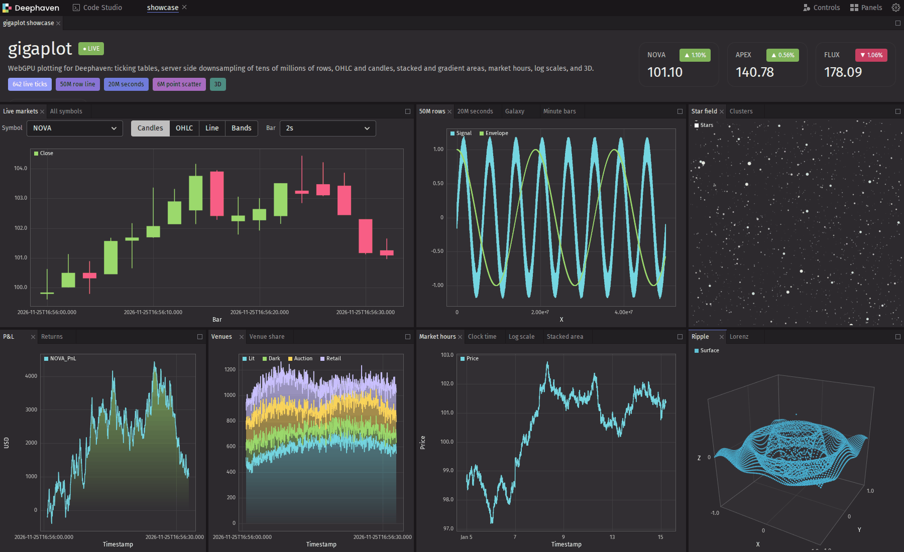

gigaplot draws with WebGPU, and falls back to Canvas 2D where WebGPU is not
available. Sources and renderers can be swapped, and the library does not depend
on Deephaven. It supports scatter, line, area, OHLC, and candlestick plots in
2D, and scatter and line plots in 3D. 2D axes can use log, exponential, power,
or business calendar scales.

## Why gigaplot

### Renderer agnostic

Renderers sit behind one `PlotRenderer` interface, and a plot picks the first
one in its preference list that the machine supports and that can draw every
series in it. WebGPU is the default, for the most performance, with Canvas 2D
as the fallback that runs everywhere. Data sources, axes, legends, and hover
never talk to a renderer directly, so a new renderer, such as SVG or WebGL,
[registers](packages/gigaplot/docs/architecture.md) without touching the rest
of the library.

### Performance

gigaplot aims to be the fastest plotting library in the browser, and ships
[a benchmark](packages/plot-benchmark) that holds it to that against Plotly,
uPlot, Lightweight Charts, ECharts, Chart.js, and deck.gl. With 10% of the
points replaced on every frame, from the
[recorded results](packages/plot-benchmark/RESULTS.md):

| 1 million points, FPS | gigaplot (WebGPU) | deck.gl | uPlot | Plotly (WebGL) | ECharts | Chart.js |
| --------------------- | ----------------: | ------: | ----: | -------------: | ------: | -------: |
| Scatter               |                60 |      60 |   2.7 |            2.7 |     1.8 |      1.0 |
| Scrolling line        |                60 |      60 |    60 |            2.6 |     4.8 |     10.0 |

At 10 million points, gigaplot is the fastest of them on both: 28 FPS on
scatter, about twice deck.gl, and 24 FPS on lines.

Speed per plot is only half of it on a dashboard. Browsers cap how many WebGL
contexts a page can have at once, about 16 in desktop Chrome and fewer on
mobile, and past that they drop the oldest, so the plots drawn first go blank.
Libraries that draw with WebGL, such as Plotly's WebGL traces and deck.gl,
create a context per plot and run into that limit. WebGPU has no such limit:
every gigaplot plot on a page shares
[one GPU device](packages/gigaplot/docs/architecture.md#webgpu-renderer), and
its canvas contexts are cheap views onto it, so a page can hold as many plots
as memory allows. The demo's 64 plots on one page are all drawn with WebGPU.

<p align="center">
  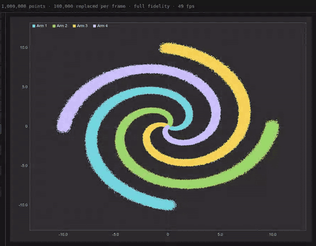
</p>

### Live data

gigaplot is built for data that never stops changing. Sources describe what
changed as deltas, such as rows appended to the end, rows updated in place, or
old rows trimmed from the start, and the WebGPU renderer writes just those bytes
into the GPU buffers it already has instead of uploading every series again.
Redraws are coalesced into one animation frame, so a table ticking faster than
the screen refreshes still draws at most once per frame. In Deephaven, plots
of ticking tables keep up as rows arrive, including the downsampled ones.

### Downsampling

No screen can show 50 million points, so gigaplot is designed to draw only
what fits, at the resolution it fits. A data source decides how to reduce its
data for each zoom, pan, and resize, and that algorithm is yours to choose:

- **Client side**: pass a `Downsampler` to `StaticDataSource`. The bundled
  min/max downsampler draws exactly what every point would, and
  [LTTB](packages/gigaplot/docs/downsampling.md#lttbdownsampler) is included
  for a fixed point budget. Write your own with the same signature.
- **Server side**: a source can ask a server for data at the current viewport.
  The Deephaven plugin does this, aggregating the table on the server so the
  browser only receives a few rows per pixel, and takes a
  [Python function](deephaven-plugin-gigaplot/README.md#how-downsampling-works)
  for your own algorithm.

While new data loads, the plot never jumps or goes blank. Zooming in scales
the data it has like a picture, pixel for pixel, and fades the detailed data
in when it arrives. Zooming out hatches the edges that have not loaded yet.
[Zoom transitions](packages/gigaplot/docs/downsampling.md#zoom-transitions)
explains how.

<p align="center">
  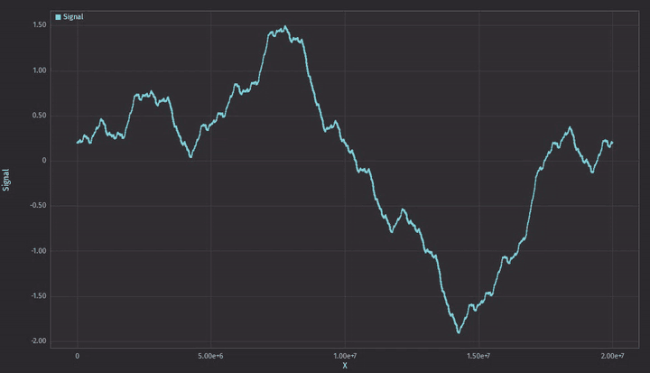
</p>

### Business time and range breaks

Markets close, but most plotting libraries keep drawing the time in between,
so nights, weekends, and holidays stretch across most of the axis as flat
lines. gigaplot's scales take them out. A business calendar scale knows the
time zone, the sessions of a day, including a lunch break, the business days,
and the holidays, including half days, and follows daylight saving. Each close
sits right beside the next open.

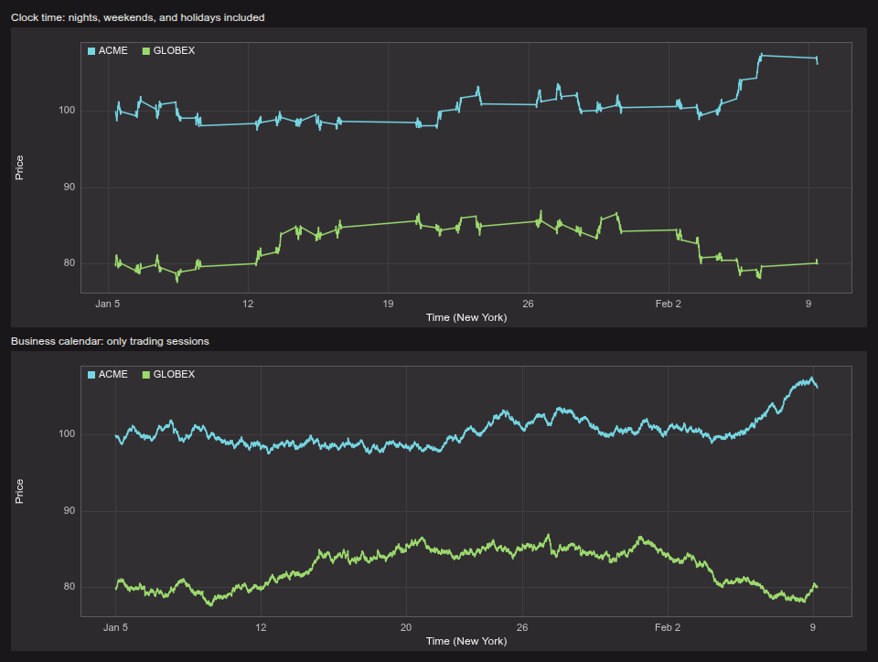

The ticks follow the calendar too: round clock times within sessions when
zoomed in, then the opens of days, weeks, and months as the view widens, spaced
by business time so a weekend takes no room. Partway through the zoom below,
Friday the 16th sits next to Tuesday the 20th, with the weekend and Martin Luther King Jr. Day gone.

<p align="center">
  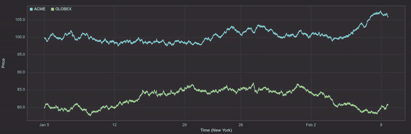
</p>

For anything else, a range break scale removes the ranges you give it, from a
list or from a function that generates them as the axis extends. Plots pan,
zoom, and downsample in positions along the scale, so breaks hold up on tables
of millions of rows, and the Deephaven plugin bins them by business time on the
server.

```tsx
const nyse = createBusinessCalendarScale({
  timeZone: "America/New_York",
  sessions: [["09:30", "16:00"]],
  holidays: ["2026-01-19"],
});

<Plot source={source} xScale={nyse} />;
```

```python
gp.line(prices, x="Timestamp", y="Price", x_scale=gp.calendar_scale("USNYSE_EXAMPLE"))
```

See [scales](packages/gigaplot/docs/scales.md) for log, exponential, and power
axes, and the
[plugin's market hours examples](deephaven-plugin-gigaplot/README.md#market-hours-and-other-scales).

## Gallery

From the [demo app](packages/gigaplot-demo), which runs with `npm start` and
needs no server.

<table>
  <tr>
    <td align="center" width="33%">
      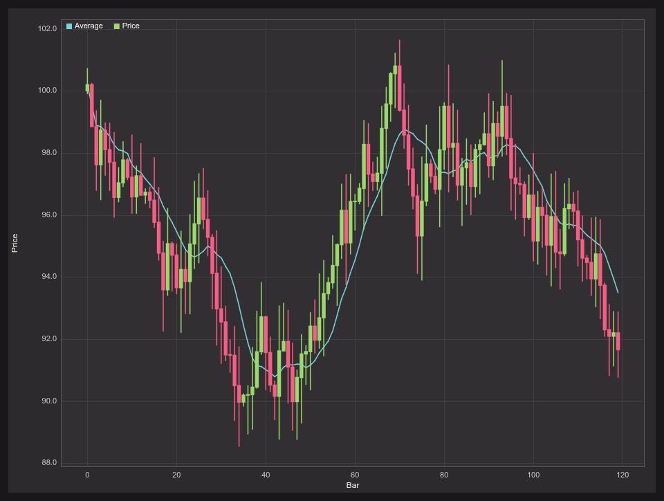<br>
      Candlestick
    </td>
    <td align="center" width="33%">
      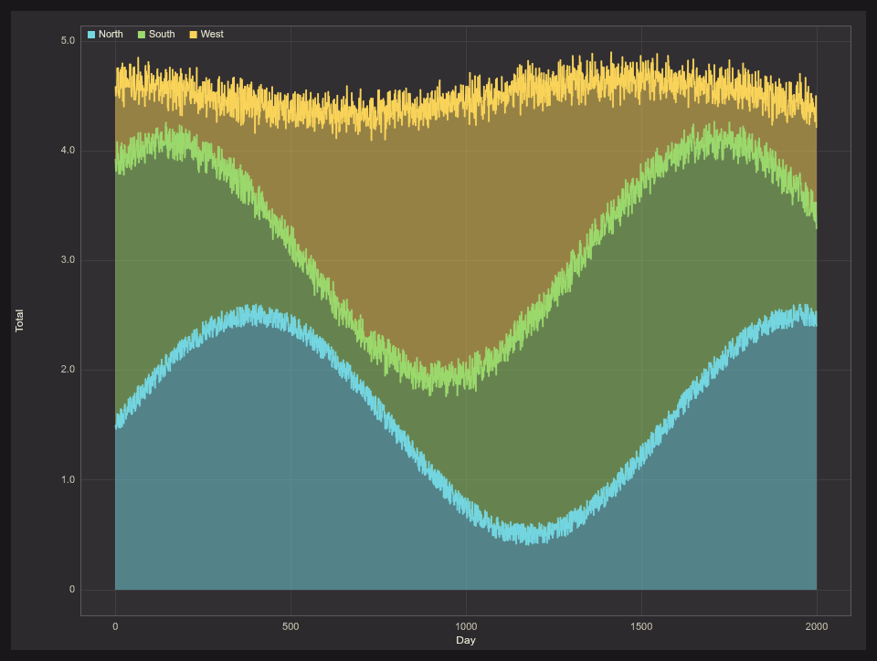<br>
      Stacked area
    </td>
    <td align="center" width="33%">
      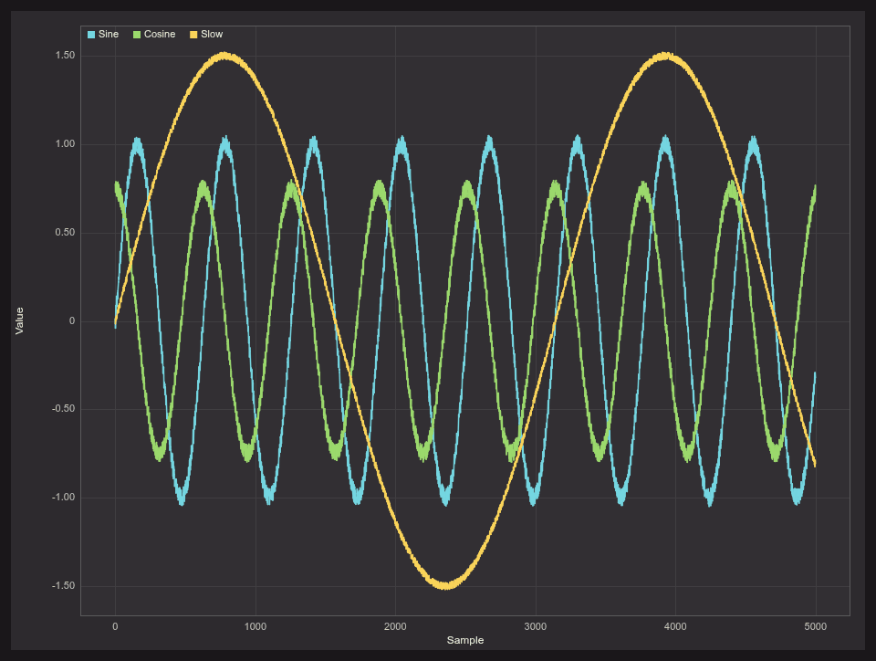<br>
      Line
    </td>
  </tr>
  <tr>
    <td align="center" width="33%">
      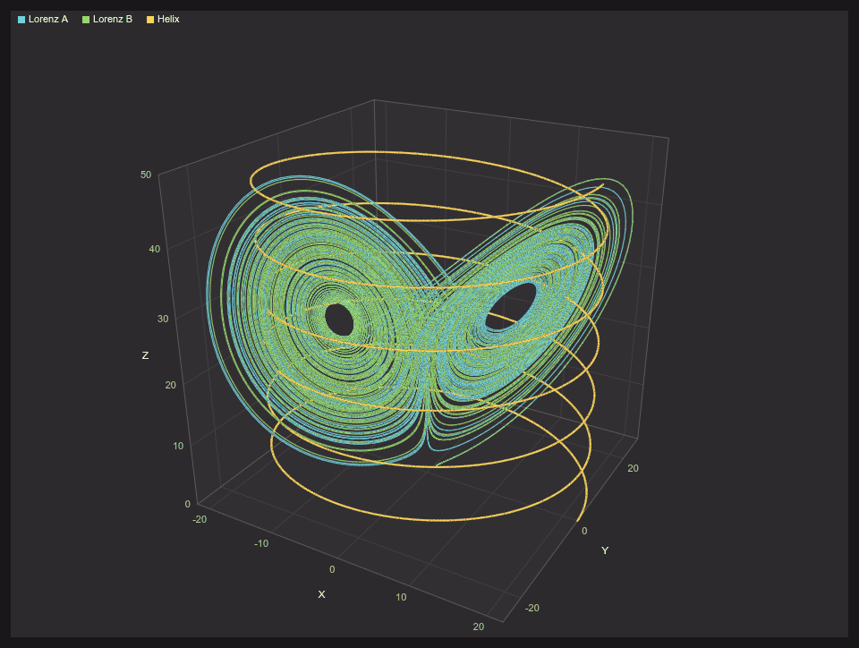<br>
      Line 3D
    </td>
    <td align="center" width="33%">
      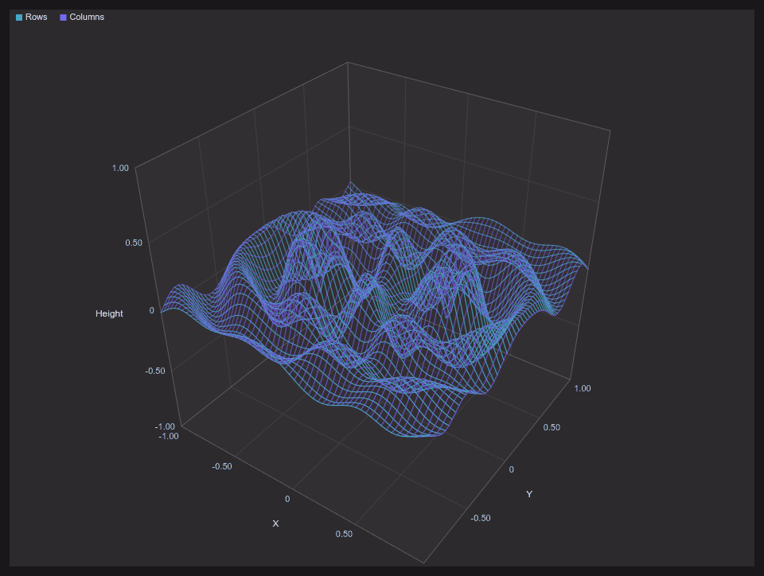<br>
      Ripple 3D
    </td>
    <td align="center" width="33%">
      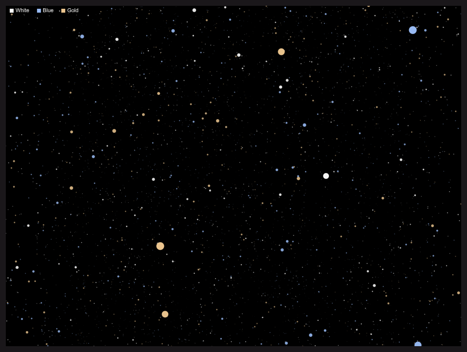<br>
      Star field
    </td>
  </tr>
  <tr>
    <td align="center" width="33%">
      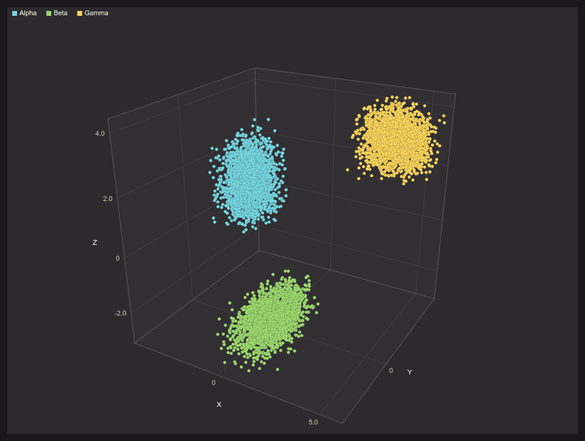<br>
      Scatter 3D
    </td>
    <td align="center" width="33%">
      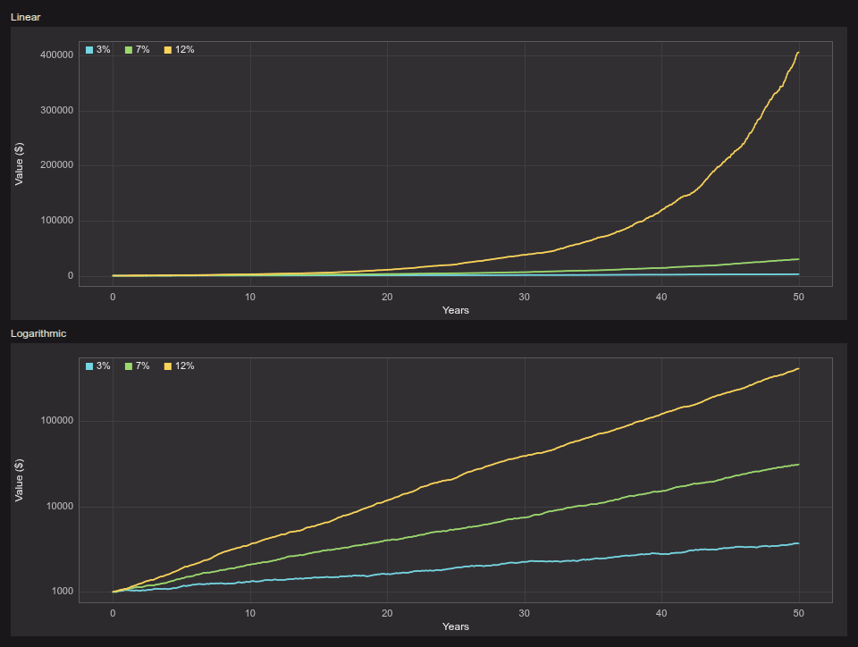<br>
      Log scale
    </td>
    <td align="center" width="33%">
      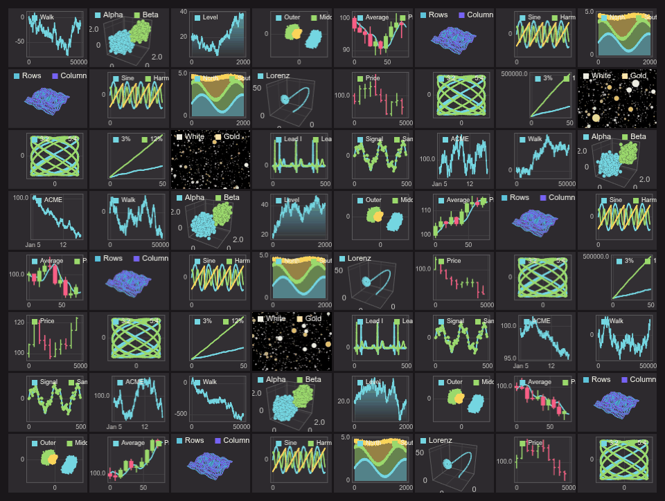<br>
      64 plots on one page
    </td>
  </tr>
</table>

## In this repository

This repository is an npm workspace containing:

- [packages/gigaplot](packages/gigaplot): the `gigaplot` plotting library
- [packages/gigaplot-demo](packages/gigaplot-demo): a standalone demo app,
  no Deephaven server required
- [packages/plot-benchmark](packages/plot-benchmark): raw rendering
  performance of gigaplot against Plotly, uPlot, Lightweight Charts, ECharts,
  Chart.js, and deck.gl
- [deephaven-plugin-gigaplot](deephaven-plugin-gigaplot): a `deephaven.ui`
  element plugin that plots tables with gigaplot, downsampling them on the
  server
- [plans](plans): plans for upcoming work

## Prerequisites

- Node.js 24 and npm. With [nvm](https://github.com/nvm-sh/nvm), run
  `nvm install 24`.
- A browser with WebGPU, such as a recent Chrome or Edge, for the GPU
  renderer. Other browsers use the Canvas 2D renderer.
- For the Deephaven plugin only: Python 3.12 and Java 17 or later.

## Getting started

```bash
git clone https://github.com/mofojed/gigaplot.git
cd gigaplot
npm install
npx playwright install chromium   # once, for the e2e tests

npm start          # runs the demo at http://localhost:9020/gigaplot/
npm run benchmark  # runs the benchmark at http://localhost:9030/
npm test           # unit tests
npm run e2e        # Playwright tests against the demo and benchmark
npm run build      # builds every package
```

Run npm commands from the repository root, not from a package.

See the [plugin README](deephaven-plugin-gigaplot/README.md) to build the
Deephaven plugin, install it, and run it in a server.

## Documentation

- [Library README](packages/gigaplot/README.md): usage, data sources,
  scales, and theming
- [Architecture](packages/gigaplot/docs/architecture.md),
  [data sources](packages/gigaplot/docs/data-sources.md),
  [downsampling](packages/gigaplot/docs/downsampling.md),
  [scales](packages/gigaplot/docs/scales.md), and
  [theming](packages/gigaplot/docs/theming.md)
- [Plugin README](deephaven-plugin-gigaplot/README.md): Python API, examples,
  and the downsampling protocol
- [Plotly Express parity plan](plans/plotly-express-parity.md): features of
  `deephaven.plot.express` that the plugin does not have yet

## Contributing

[AGENTS.md](AGENTS.md) describes the layout, validation, formatting, and
conventions, and applies to people as much as to coding agents. Agent skills
for the library and the plugin are in [.github/skills](.github/skills).

Commit messages follow
[Conventional Commits](https://www.conventionalcommits.org/), such as
`fix(view): draw plots whose bounds arrive while the renderer initializes`.

## License

[Apache License 2.0](LICENSE)
