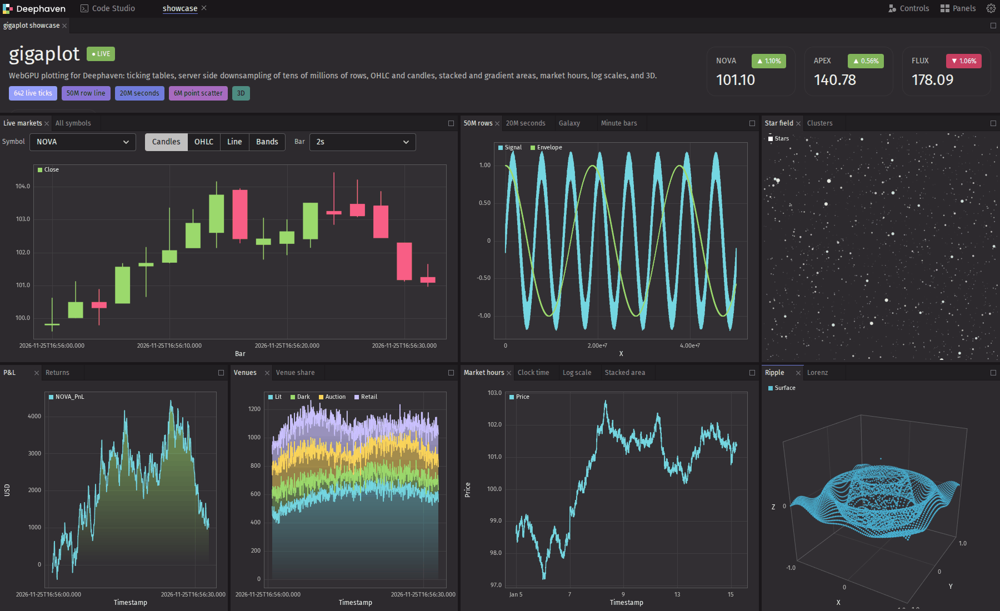
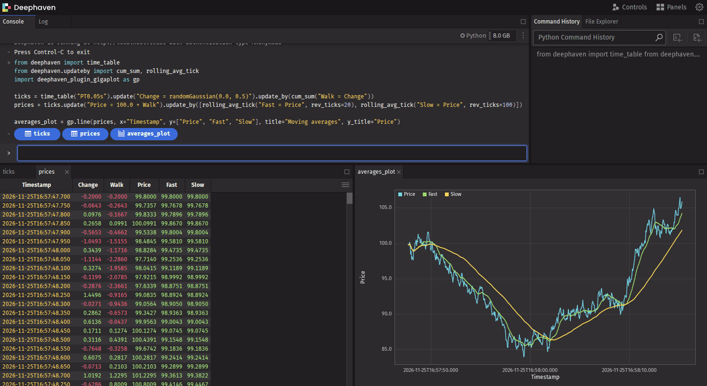
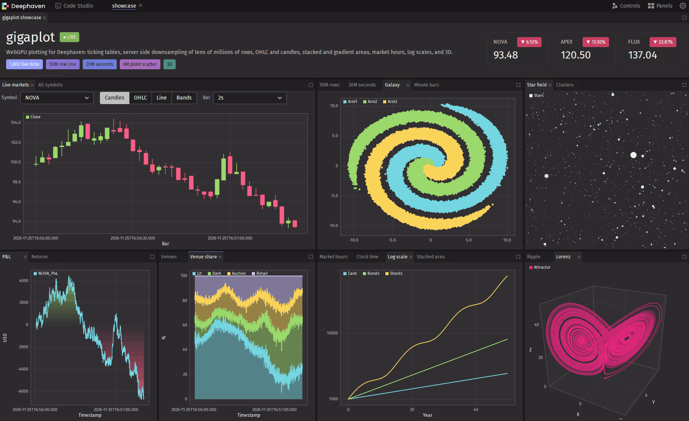
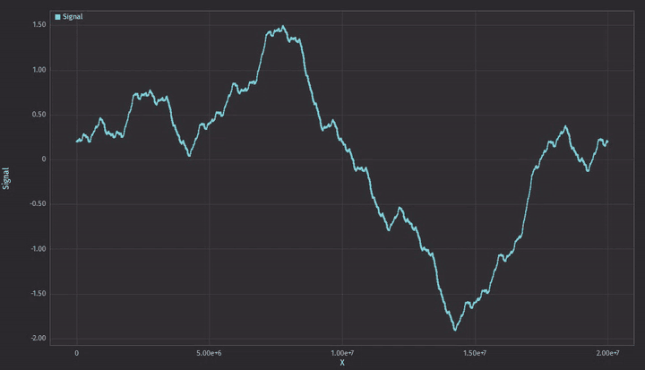
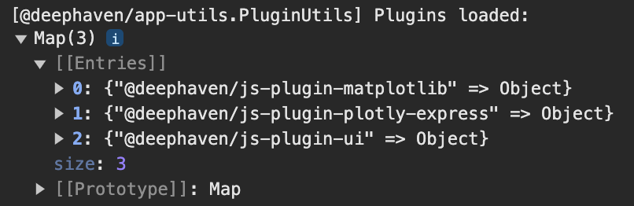
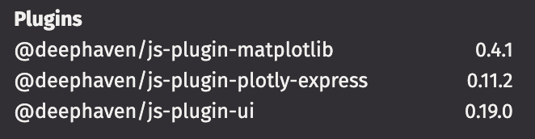

# deephaven-plugin-gigaplot

A Deephaven element plugin that plots tables with [gigaplot](../packages/gigaplot), generated from the element template in [deephaven-plugins](https://github.com/deephaven/deephaven-plugins).

> [!WARNING]
> This plugin is experimental. It is not published yet, and its Python API may change without notice.

Plots draw with WebGPU, follow ticking tables as they update, and downsample tables of tens of millions of rows on the server, so the browser only receives what fits on screen. See [Using the Plugin](#using-the-plugin) to get started.



## Plugin Structure

The `src` directory contains the Python and JavaScript code for the plugin.  
Within the `src` directory, the deephaven_plugin_gigaplot directory contains the Python code, and the `js` directory contains the JavaScript code.

The Python files have the following structure:  
`gigaplot.py` defines the `line`, `scatter`, `area`, `ohlc`, and `candlestick` plots. Each renders the same component, which maps to the `GigaplotView` React element. It holds the plot's viewport as state and downsamples the table for it. It also defines `scatter3d` and `line3d`, which send the whole table, since 3D plots are not downsampled.  
`downsample.py` turns a table into a smaller table that draws the same at a given viewport and resolution.  
`scales.py` defines the axis scales, such as `log_scale` and `calendar_scale`, and the formulas the server bins by.  
`register.py` registers the plugin with Deephaven.

The JavaScript files have the following structure:  
`GigaplotPlugin.ts` registers the plugin with Deephaven. Its `mapping` keys must match the element names in `gigaplot.py`.  
`GigaplotView.tsx` fetches the tables passed from Python and renders a gigaplot `Plot`.  
`TableDataSource.ts` is a gigaplot data source that subscribes to the table and replaces every series on each update. When downsampling, it asks Python for a new table as the plot zooms, pans, and resizes, and swaps it in once it has data.  
`downsampleParams.ts` turns a viewport and plot size into the params sent to Python.  
`DownsamplingIndicator.tsx` is the status shown while a downsampled table is loading.

The JS package is a member of the npm workspace at the repository root, which is how it resolves `gigaplot`. Run `npm install` from the repository root, not from `src/js`. The bundle is built from the gigaplot source, so gigaplot does not need to be built first.

## Using plugin_builder.py

The `plugin_builder.py` script is the recommended way to build the plugin.
See [Building the Plugin](#building-the-plugin) for more information if you want to build the plugin manually instead.

To use `plugin_builder.py`, first set up your Python environment and install the required packages.  
To build the plugin, you will need `npm` and `python` installed, as well as the `build` package for Python.
`nvm` is also strongly recommended, and an `.nvmrc` file is included in the project.
The script uses `watchdog` and `deephaven-server` for `--watch` mode and `--server` mode, respectively.

```sh
# From the repository root
npm install
cd deephaven-plugin-gigaplot
python3.12 -m venv .venv
source .venv/bin/activate
pip install --upgrade -r requirements.txt
pip install deephaven-server watchdog click
```

First, run an initial install of the plugin:
This builds and installs the full plugin, including the JavaScript code.

```sh
python plugin_builder.py --install --js
```

After this, more advanced options can be used.
For example, if only iterating on the plugins with no version bumps, use the `--reinstall` flag for faster builds.
This adds `--force-reinstall --no-deps` to the `pip install` command.

```sh
python plugin_builder.py --reinstall --js
```

If only the Python code has changed, the `--js` flag can be omitted.

```sh
python plugin_builder.py --reinstall
```

Additional especially useful flags are `--watch` and `--server`.
`--watch` will watch the Python and JavaScript files for changes and rebuild the plugin when they are modified.
`--server` will start the Deephaven server with the plugin installed.
Taken in combination with `--reinstall` and `--js`, this command will rebuild and restart the server when changes are made to the plugin.

```sh
python plugin_builder.py --reinstall --js --watch --server
```

If interested in passing args to the server, the `--server-arg` flag can be used as well
Check `deephaven server --help` for more information on the available arguments.

```sh
python plugin_builder.py --reinstall --js --watch --server --server-arg --port=9999
```

See [Using the Plugin](#using-the-plugin) for more information on how to use the plugin.

## Manually Building the Plugin

To build the plugin, you will need `npm` and `python` installed, as well as the `build` package for Python.
`nvm` is also strongly recommended, and an `.nvmrc` file is included in the project.
The python venv can be created and the recommended packages installed with the following commands:

```sh
cd deephaven-plugin-gigaplot
python -m venv .venv
source .venv/bin/activate
pip install --upgrade -r requirements.txt
```

Build the JavaScript plugin from the `src/js` directory, after running `npm install` from the repository root:

```sh
cd src/js
npm run build
```

Then, build the Python plugin from the top-level directory:

```sh
cd ../..
python -m build --wheel
```

The built wheel file will be located in the `dist` directory.

If you modify the JavaScript code, remove the `build` and `dist` directories before rebuilding the wheel:

```sh
rm -rf build dist
```

## Installing the Plugin

The plugin can be installed into a Deephaven instance with `pip install <wheel file>`.
The wheel file is stored in the `dist` directory after building the plugin.
Exactly how this is done will depend on how you are running Deephaven.
If using the venv created above, the plugin and server can be created with the following commands:

```sh
pip install deephaven-server
pip install dist/deephaven_plugin_gigaplot-0.0.1.dev0-py3-none-any.whl
deephaven server
```

See the [plug-in documentation](https://deephaven.io/core/docs/how-to-guides/use-plugins/) for more information.

## Using the Plugin

Once the Deephaven server is running, the plugin should be available to use.

```python
from deephaven import time_table
import deephaven_plugin_gigaplot as gp

ticking = time_table("PT0.1s").update(["X = ii", "Sin = Math.sin(ii / 20.0)", "Cos = Math.cos(ii / 20.0)"])

line_plot = gp.line(ticking, x="X", y=["Sin", "Cos"], title="Waves")
scatter_plot = gp.scatter(ticking, x="Sin", y="Cos")
```

In Code Studio, each plot opens in a panel of its own and updates as its table ticks:



For a tour of everything below in one `deephaven.ui` dashboard, with live markets, tens of millions of rows, scales, and 3D, run [examples/showcase_dashboard.py](examples/showcase_dashboard.py), such as with `exec(open("examples/showcase_dashboard.py").read())`. It needs several GB of heap, such as `-Xmx8g`. To compare, [examples/showcase_plotly.py](examples/showcase_plotly.py) draws the same dashboard with `deephaven.plot.express`.



There is a function per plot type, like `deephaven.plot.express`: `gp.line`, `gp.scatter`, `gp.area`, `gp.ohlc`, and `gp.candlestick`, and in 3D `gp.scatter3d` and `gp.line3d`. They share the options below, except where [3D plots](#3d-plots) say otherwise. 2D plots also take `x_scale` and `y_scale`, for [market hours and other scales](#market-hours-and-other-scales).

Numeric and `Instant` columns are supported.
`Instant` values keep full nanosecond precision, and their axis is labelled with dates in the time zone and date time format from your workspace settings, including any format rule for the column. The labels show more fractional seconds when you zoom in far enough to need them.
Line series expect the table to be sorted by `x`.
Axes are titled with the column names by default. Pass `x_title` or `y_title` to change a title, or an empty string to hide it. With several `y` columns the y axis has no default title, since the legend names each series.
Plots use the active Deephaven theme, including custom themes, and update when the theme is switched.

Hovering a line plot shows every series' value at the x under the cursor, in a tooltip box with markers on the points. Scatter series show a point's values when the cursor is over it. `Instant` values are shown as dates, formatted like the axis. Pass `tooltip` to choose what is drawn: `False` for nothing, or a list of `"box"`, `"markers"`, `"guides"` (dashed lines from the points to the axes), `"x_axis_label"` (the hovered x labelled on the x axis), and `"y_axis_labels"` (each hovered value labelled on the y axis in its series' color).

```python
# Values labelled on the axes instead of in a box
axis_hover_plot = gp.line(
    ticking, x="X", y=["Sin", "Cos"], tooltip=["markers", "guides", "x_axis_label", "y_axis_labels"]
)
```

### Multiple series

Each column in `y` is plotted as its own series against the shared `x` column. Series are named after their columns in the legend and take their colors from the theme colorway in order. Every series in a plot has the same type.
The legend is drawn across the top of the plot by default. Pass `legend_position="right"` to list the series in a column beside the plot instead, so it never covers the data.

```python
from deephaven import empty_table, time_table
from deephaven.updateby import cum_sum, rolling_avg_tick
import deephaven_plugin_gigaplot as gp

# A ticking price with a fast and a slow moving average
prices = (
    time_table("PT0.1s")
    .update("Change = randomGaussian(0.0, 0.5)")
    .update_by(cum_sum("Walk = Change"))
    .update("Price = 100.0 + Walk")
    .update_by(
        [
            rolling_avg_tick("Fast = Price", rev_ticks=20),
            rolling_avg_tick("Slow = Price", rev_ticks=100),
        ]
    )
)
averages_plot = gp.line(
    prices, x="Timestamp", y=["Price", "Fast", "Slow"], title="Moving averages", x_title="Time", y_title="Price"
)

# Three noisy sensors measuring the same input, as scatter series
readings = empty_table(1_000_000).update(
    [
        "Input = random() * 100.0",
        "SensorA = Input * 0.5 + randomGaussian(0.0, 2.0)",
        "SensorB = Input * 0.8 + randomGaussian(10.0, 5.0)",
        "SensorC = 40.0 + randomGaussian(0.0, 8.0)",
    ]
)
sensors_plot = gp.scatter(readings, x="Input", y=["SensorA", "SensorB", "SensorC"], title="Sensors")
```

Data in long format, with one row per key, needs one column per series. Filter each key and join it on `x`:

```python
# One row per symbol per minute
ticks = (
    empty_table(3 * 500_000)
    .update(
        [
            "Sym = ii % 3 == 0 ? `AAPL` : ii % 3 == 1 ? `MSFT` : `GOOG`",
            "Timestamp = '2024-01-01T00:00:00Z' + ((long) (ii / 3)) * MINUTE",
            "Change = randomGaussian(0.0, 0.2)",
        ]
    )
    .update_by(cum_sum("Walk = Change"), by="Sym")
    .update("Price = 100.0 + Walk")
)

syms = ["AAPL", "MSFT", "GOOG"]
by_sym = ticks.where(f"Sym = `{syms[0]}`").view(["Timestamp", f"{syms[0]} = Price"])
for sym in syms[1:]:
    by_sym = by_sym.natural_join(ticks.where(f"Sym = `{sym}`"), on="Timestamp", joins=f"{sym} = Price")

symbols_plot = gp.line(by_sym, x="Timestamp", y=syms, title="Prices by symbol")
```

### Area plots

`gp.area` fills each `y` column down to zero, with its line along the top. Like `dx.area` in `deephaven.plot.express`, several columns are stacked, each on top of the one before it, so the top area shows their total. Missing values count as zero. Hovering lists each column's own value, not the total. The table should be sorted by `x`.

Pass `groupnorm="percent"` to show each column as a percent of the total at each x, or `"fraction"` for a fraction of 1. Pass `stacked=False` to fill every column down to zero instead, overlapping each other.

```python
from deephaven import empty_table
import deephaven_plugin_gigaplot as gp

# One row per minute for a week
traffic = empty_table(7 * 1440).update(
    [
        "Timestamp = '2024-01-01T00:00:00Z' + ii * MINUTE",
        "Web = 50 + 30 * Math.sin(ii / 1440.0 * 2 * Math.PI) + randomGaussian(0.0, 5.0)",
        "Mobile = 80 + 40 * Math.sin(ii / 1440.0 * 2 * Math.PI + 1) + randomGaussian(0.0, 5.0)",
        "Api = 20 + randomGaussian(0.0, 2.0)",
    ]
)
stacked_plot = gp.area(traffic, x="Timestamp", y=["Web", "Mobile", "Api"], title="Requests")
share_plot = gp.area(traffic, x="Timestamp", y=["Web", "Mobile", "Api"], groupnorm="percent", title="Share")
overlap_plot = gp.area(traffic, x="Timestamp", y=["Web", "Mobile"], stacked=False)
```

By default an area is its line color, half transparent. Pass `fill` to change it: a CSS color, or a gradient from `gp.linear_gradient`, for every area, or a list with one per `y` column, where `None` keeps the default.

A gradient blends between its stops from the top of the plot to the bottom, or from left to right with `direction="horizontal"`. A stop is a CSS color, or a dict with any of `offset`, `color`, and `opacity`. A stop without a `color` uses the series color, and stops without an `offset` are spaced evenly. With `units="data"`, offsets are values on the axis instead, so the gradient moves with the data. Colors blend without premultiplying alpha, so fade out with `{"opacity": 0}` rather than `"transparent"`, which greys the color on the way.

```python
# The series color fading out towards the bottom of the plot
faded_plot = gp.area(
    traffic, x="Timestamp", y="Web", fill=gp.linear_gradient([{"opacity": 0.8}, {"opacity": 0}])
)

# Green above zero and red below, with a hard edge at zero
change = traffic.update("Change = Web - 50")
change_plot = gp.area(
    change,
    x="Timestamp",
    y="Change",
    fill=gp.linear_gradient(
        [{"offset": 0, "color": "#f85e85", "opacity": 0.6}, {"offset": 0, "color": "#9bd96c", "opacity": 0.6}],
        units="data",
    ),
)
```

### OHLC and candlestick plots

`gp.ohlc` and `gp.candlestick` plot price bars from `open`, `high`, `low`, and `close` columns. An OHLC bar is a line from the low to the high, with a tick to the left at the open and to the right at the close. A candlestick has a body from the open to the close instead. Bars that close below their open are drawn in the theme's decreasing color, and the rest in its increasing color. The table should be sorted by `x`.

```python
from deephaven import agg, empty_table
from deephaven.updateby import cum_sum
import deephaven_plugin_gigaplot as gp

# One second ticks for a week, resampled into one minute bars
ticks = (
    empty_table(7 * 24 * 60 * 60)
    .update(["Timestamp = '2024-01-01T00:00:00Z' + ii * SECOND", "Change = randomGaussian(0.0, 0.02)"])
    .update_by(cum_sum("Walk = Change"))
    .update("Price = 100.0 + Walk")
)
bars = ticks.update_view("Minute = lowerBin(Timestamp, MINUTE)").agg_by(
    [agg.first("Open = Price"), agg.max_("High = Price"), agg.min_("Low = Price"), agg.last("Close = Price")],
    by="Minute",
)

ohlc_plot = gp.ohlc(bars, x="Minute", open="Open", high="High", low="Low", close="Close", title="One minute bars")
candles_plot = gp.candlestick(bars.tail(120), x="Minute", open="Open", high="High", low="Low", close="Close")
```

Hovering snaps to the bar under the cursor and lists its open, high, low, and close. The y axis has no title by default; pass `y_title` to add one.

Pass a list of columns to each of `open`, `high`, `low`, and `close` to plot several series, one per index. A series is named after its close column.

The same column can fill several roles. Passing a raw price column as all four plots each row as a flat bar, and wherever rows are combined, the bar shows their range:

```python
ticks_plot = gp.candlestick(ticks, x="Timestamp", open="Price", high="Price", low="Price", close="Price")
```

When there are more bars than fit, neighbouring bars are combined into longer periods, so bars stay 4 to 8 pixels apart: each combined bar has the first open, the highest high, the lowest low, and the last close of the bars it covers. Zoom in and the original bars come back.

### 3D plots

`gp.scatter3d` and `gp.line3d` plot `x`, `y`, and `z` columns in a box the camera orbits. Drag to rotate, scroll to zoom, and double click to reset the camera. Hovering a point, or a vertex of a line, lists its x, y, and z. Lines join their points in table order.

Pass a list of columns to `y` and `z` to plot several series: series `i` is made of `x`, `y[i]`, and `z[i]`, and a single `y` or `z` column is shared by every series. A series is named after its z column, or after its y column when several series share one z column. Pass `color` for one CSS color or one per series, and `size` (`width` for lines) in pixels.

3D data is not downsampled, so the whole table is sent to the client. Filter or `tail` large tables first. The box fits the data, following a ticking table; pass `x_range`, `y_range`, or `z_range` as `(min, max)` to fix an axis instead.

```python
from deephaven import empty_table
import deephaven_plugin_gigaplot as gp

spiral = empty_table(2000).update(["T = ii / 50.0", "X = Math.cos(T) * T", "Y = Math.sin(T) * T", "Z = T"])
spiral_plot = gp.line3d(spiral, x="X", y="Y", z="Z", width=2)

clusters = empty_table(3000).update(
    [
        "X = randomGaussian(ii % 3 * 4.0, 1.0)",
        "Y = randomGaussian(ii % 3 == 1 ? 3.0 : 0.0, 1.0)",
        "Z = randomGaussian(ii % 3 == 2 ? 4.0 : 0.0, 1.0)",
    ]
)
clusters_plot = gp.scatter3d(clusters, x="X", y="Y", z="Z", title="Clusters")
```

`camera` sets where the plot is viewed from: `azimuth`, degrees around the z axis, `elevation`, degrees above the x-y plane, `distance` from the center of the box in half box widths, where below 1 is inside it, and `fov`, the vertical field of view. `point_scaling="perspective"` draws nearer points bigger, `depth_fade` fades farther data, from 0 to 1, and `show_axes=False` hides the box. Together they make a ticking star field, with a camera at the top of the box looking down as the stars stream up past it:

```python
from deephaven import empty_table, time_table
import deephaven_plugin_gigaplot as gp

stars = empty_table(4000).update(["X = Math.random() * 2 - 1", "Y = Math.random() * 2 - 1", "Z0 = Math.random() * 2"])
# One row holding the time, so every star moves on each tick
clock = time_table("PT0.05s").last_by().view("T = epochMillis(Timestamp) / 1000.0")
field = stars.join(clock).update_view("Z = (Z0 + T * 0.4) % 2.0 - 1.0")

star_field = gp.scatter3d(
    field,
    x="X",
    y="Y",
    z="Z",
    color="white",
    size=2,
    camera={"azimuth": -90, "elevation": 90, "distance": 1, "fov": 60},
    show_axes=False,
    point_scaling="perspective",
    depth_fade=1,
    x_range=(-1, 1),
    y_range=(-1, 1),
    z_range=(-1, 1),
)
```

### Market hours and other scales

Pass `x_scale` or `y_scale` to change how an axis maps values to positions. The table is downsampled into bins that are even along the scale, so every scale works on large tables too.

`gp.calendar_scale` removes the time between business sessions: nights, weekends, and holidays. The close of each session sits right beside the next open, so 16:00 on Monday runs straight into 09:30 on Tuesday, and Friday's close into Monday's open. Ticks fall on times within sessions when zoomed in, and on the opens of days, weeks, and months as you zoom out. Use a Deephaven business calendar by name or object, such as the bundled `"USNYSE_EXAMPLE"`, or describe the schedule:

```python
from deephaven import time_table
from deephaven.calendar import calendar
from deephaven.updateby import cum_sum
import deephaven_plugin_gigaplot as gp

nyse = calendar("USNYSE_EXAMPLE")

# A minute bar every 20 ms, only during NYSE sessions, with a gap at each open
prices = (
    time_table("PT0.02s")
    .update(
        [
            "Bar = ii",
            "Timestamp = nyse.plusBusinessDays('2026-01-05T09:30:00 ET', (int) (Bar / 390)) + (Bar % 390) * MINUTE",
            "Change = randomGaussian(0.0, 0.05) + (Bar % 390 == 0 ? randomGaussian(0.0, 0.8) : 0.0)",
        ]
    )
    .update_by(cum_sum("Walk = Change"))
    .update("Price = 100.0 + Walk")
)

# Nights, weekends, and holidays are long flat lines in clock time
clock_time = gp.line(prices, x="Timestamp", y="Price", title="Clock time")
# and gone on a business calendar
business_time = gp.line(prices, x="Timestamp", y="Price", title="Business time", x_scale=gp.calendar_scale(nyse))

# The same hours described by hand, with a lunch break and a half day
lunch_time = gp.line(
    prices,
    x="Timestamp",
    y="Price",
    x_scale=gp.calendar_scale(
        time_zone="America/New_York",
        sessions=[("09:30", "12:00"), ("13:00", "16:00")],
        holidays={"2026-01-19": [], "2026-01-20": [("09:30", "13:00")]},
    ),
)
```

`calendar_scale` takes a calendar name or a `deephaven.calendar` business calendar, whose time zone, business hours, weekend, and holidays, including half days, are used. Without one, describe the schedule with `time_zone`, `sessions` (pairs of local `HH:MM` times, several for a lunch break), `business_days` (0 for Sunday to 6 for Saturday), and `holidays` (dates, or a dict of dates to their own sessions for half days). Values outside sessions sit at the next open. Numeric x columns are read as epoch milliseconds.

`gp.breaks_scale` removes ranges of your own choosing, as `(start, end)` pairs of numbers, or of times for an `Instant` column:

```python
lunch_free = gp.line(prices, x="Timestamp", y="Price", x_scale=gp.breaks_scale([("2026-01-05T12:00:00 ET", "2026-01-05T13:00:00 ET")]))
```

The y axis, or a numeric x axis, can be logarithmic, exponential, or a power:

```python
from deephaven import empty_table

growth = empty_table(600).update(["Year = ii / 12.0", "Bonds = 1000 * Math.pow(1.0025, ii)", "Stocks = 1000 * Math.pow(1.006, ii)"])

# Constant growth is a straight line on a log axis. "log" is base 10.
log_plot = gp.line(growth, x="Year", y=["Bonds", "Stocks"], y_scale="log")
# A value v sits at 10 ** v, so a logarithm, such as decibels, is drawn in proportion to what it measures
decibels = growth.update("Bels = Math.log10(Stocks)")
exp_plot = gp.line(decibels, x="Year", y="Bels", y_scale=gp.exp_scale(10))
# A value v sits at v ** 2, so a square root is a straight line
pow_plot = gp.line(growth.update("Root = Math.sqrt(Year)"), x="Year", y="Root", y_scale=gp.pow_scale(2))
```

Values with no place on a scale, such as zero or below on a log axis, are left out. Calendars and breaks only fit the x axis.

### Large tables

Tables are downsampled on the server, so the client only receives what the plot can show at its current size, zoom, and pan.
These examples plot tens of millions of rows; give the server enough heap, such as `-Xmx8g`.

```python
from deephaven import empty_table
from deephaven.updateby import cum_sum
import deephaven_plugin_gigaplot as gp

# 50 million rows, two series
waves = empty_table(50_000_000).update(
    [
        "X = ii",
        "Signal = Math.sin(ii / 1.0e6) + Math.sin(ii / 997.0) * 0.1 + randomGaussian(0.0, 0.02)",
        "Envelope = Math.cos(ii / 3.0e6)",
    ]
)
waves_plot = gp.line(waves, x="X", y=["Signal", "Envelope"], title="50 million rows")

# A random walk with one row per second for 20 million seconds
prices = (
    empty_table(20_000_000)
    .update(["Timestamp = '2024-01-01T00:00:00Z' + ii * SECOND", "Change = randomGaussian(0.0, 0.05)"])
    .update_by(cum_sum("Price = Change"))
)
prices_plot = gp.line(prices, x="Timestamp", y="Price", title="20 million seconds")

# 10 million scatter points in three clusters
clusters = empty_table(10_000_000).update(
    [
        "Cluster = (int) (ii % 3)",
        "X = randomGaussian(Cluster * 4.0, 1.0)",
        "Y = randomGaussian(Cluster * 2.0, 0.5 + Cluster * 0.5)",
    ]
)
clusters_plot = gp.scatter(clusters, x="X", y="Y", title="10 million points")
```

Zoom in on `prices_plot` and the detail fills in down to individual seconds. While the next table loads, the plot scales up the one it has instead of going blank, then fades the detailed one in:



### How downsampling works

Each plot keeps its viewport in `deephaven.ui` state. The client reports the viewport and size it needs drawn, and the component re-renders with a downsampled table for it, which is all the client subscribes to:

1. A one row table of the full extent, from `bounds`, sets the initial viewport. For areas, `area_bounds` also includes zero.
2. The client sends the x range and bin width, rounded to powers of two. Small pans and zooms reuse the current table, and the range has a margin so panning stays covered while the next table loads.
3. `downsample` filters the table to the range and aggregates it per bin:
   - Lines keep the first, minimum, maximum, and last value in each bin, with bins at most a pixel wide. This draws the same line as every point would.
   - Areas are downsampled like lines. Stacked areas are summed first, so each column holds the running total, and every total keeps the same rows, so each area meets the one below it exactly.
   - Scatter keeps one point per grid cell of up to 3 pixels, so dense regions send far fewer rows than points.
   - OHLC and candlestick bars are resampled into one bar per bin of 4 to 8 pixels, with the first open, highest high, lowest low, and last close.
4. The client keeps drawing the old table until the new one has data, then swaps it in. A small "Downsampling…" status with a spinner shows in the bottom right of the plot while it waits.

Downsampled tables are aggregations, so a ticking source keeps them ticking. The zoomed out view of a live table follows new rows without new queries until the range has grown enough to need a coarser table.

The downsampling functions can be used on their own to get a reduced table:

```python
from deephaven_plugin_gigaplot import downsample_line, downsample_ohlc, downsample_scatter

# At most 4 rows per 10,000 rows of x, from x = 1,000,000 to 2,000,000
reduced = downsample_line(waves, "X", ["Signal", "Envelope"], x_bin=10_000, x_range=(1_000_000, 2_000_000))
```

Pass your own algorithm as `downsample`. It receives the table, the x column, the value columns, and a `Viewport` dict with `x_min`, `x_max`, and `x_bin`, plus `y_min`, `y_max`, and `y_bin` for scatter plots. The value columns are the y columns, holding running totals for stacked areas, or for OHLC and candlestick plots, the open, high, low, and close columns of each series in turn. A column used for more than one of those is passed as an alias of its own, so each can be aggregated differently. It should return a table with the same x and value columns. Define it outside the component so it is not recreated on each render.

On an axis with a scale, `x_bin` and `y_bin` are in positions on the scale, while the ranges stay in column units. The viewport passed to your downsampler holds the scales as `x_scale` and `y_scale`; pass them on to `downsample_line`, `downsample_ohlc`, or `downsample_scatter`, which bin by position, or use `Scale.position` for the formula of a column's position.

For an `Instant` column, the viewport values are nanoseconds since an origin, which is given in epoch nanoseconds as an integer `x_origin` or `y_origin`. Subtract it from `epochNanos(column)` as a `long` before converting to `double`, so values keep nanosecond precision. `downsample_line`, `downsample_ohlc`, and `downsample_scatter` take the same origins as `x_origin` and `y_origin` arguments.

```python
from deephaven import agg


def bin_averages(table, x, ys, viewport):
    """Plots the average of each bin instead of its extremes."""
    return (
        table.where(f"{x} >= {viewport['x_min']} && {x} <= {viewport['x_max']}")
        .update_view(f"Bin = (long) Math.floor({x} / {viewport['x_bin']})")
        .agg_by([agg.avg([x] + ys)], by="Bin")
        .sort("Bin")
    )


averaged_plot = gp.line(waves, x="X", y="Signal", downsample=bin_averages)
```

Pass `downsample=False` to subscribe to the whole table instead. This is fine for small tables, but is not suited to large ones.

## Debugging the Plugin

It's recommended to run through all the steps in [Using plugin_builder.py](#Using-plugin_builder.py) and [Using the Plugin](#Using-the-plugin) to ensure the plugin is working correctly.  
Then, make changes to the plugin and rebuild it to see the changes in action.
Checkout the [Deephaven plugins repo](https://github.com/deephaven/deephaven-plugins), which is where this template was generated from, for more examples and information.  
The `plugins` folder contains current plugins that are developed and maintained by Deephaven.  
Below are some common issues and how to resolve them as you develop your plugin.  
If there is an issue with the process while following the Installation and Usage steps on the originally generated plugin, please open an issue.

### The Panel is Not Appearing

#### Checking if the Plugin is Registered

If the panel is not appearing or an error is thrown that the import is not found, the plugin may not be registered correctly.
To verify the plugin is registered, check either the console logs or the versions in the settings panel.

- In the console logs, there should be a messaging saying `Plugins loaded:` with a map that includes this plugin.  
  

- To get to the settings panel, click on the gear icon in the top right corner of the Deephaven window. Towards the bottom this plugin should be listed.  
  
- If the plugin is not listed, attempt to rebuild and reinstall the plugin and check for errors during that process.

#### Checking if the Python Package is Installed

- Running `pip list` in the `.venv` environment should show the Python package installed, but this is not a guarantee that the plugin is registered properly.
- The version can also be checked directly from the Python console with:

```{python}
from importlib.metadata import version
print(version("deephaven_plugin_gigaplot"))
```

### The Panel is Appearing but with Errors or Not Functioning Correctly

Check both the Python and JavaScript logs for errors as either side could be causing the issue.

## Distributing the Plugin

To distribute the plugin, you can upload the wheel file to a package repository, such as [PyPI](https://pypi.org/).
The version of the plugin can be updated in the `setup.cfg` file.

There is a separate instance of PyPI for testing purposes.
Start by creating an account at [TestPyPI](https://test.pypi.org/account/register/).
Then, get an API token from [account management](https://test.pypi.org/manage/account/#api-tokens), setting the “Scope” to “Entire account”.

To upload to the test instance, use the following commands:

```sh
python -m pip install --upgrade twine
python -m twine upload --repository testpypi dist/*
```

Now, you can install the plugin from the test instance. The extra index is needed to find dependencies:

```sh
pip install --index-url https://test.pypi.org/simple/ --extra-index-url https://pypi.org/simple/ deephaven_plugin_gigaplot
```

For a production release, create an account at [PyPI](https://pypi.org/account/register/).
Then, get an API token from [account management](https://pypi.org/manage/account/#api-tokens), setting the “Scope” to “Entire account”.

To upload to the production instance, use the following commands.
Note that `--repository` is the production instance by default, so it can be omitted:

```sh
python -m pip install --upgrade twine
python -m twine upload dist/*
```

Now, you can install the plugin from the production instance:

```sh
pip install deephaven_plugin_gigaplot
```

See the [Python packaging documentation](https://packaging.python.org/en/latest/tutorials/packaging-projects/#uploading-the-distribution-archives) for more information.
