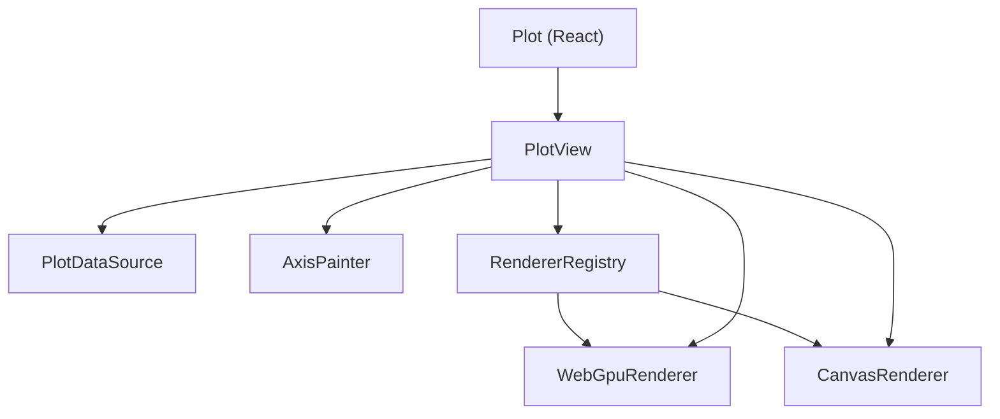

# Architecture

## Layers



- **`PlotDataSource`** supplies the shape and the data. It knows nothing about
  rendering.
- **`PlotView`** owns the DOM, the viewport, and the data request lifecycle. It
  is framework free.
- **`PlotRenderer`** draws series into a canvas. It knows nothing about where
  data came from.
- **`Plot`** is a thin React wrapper around `PlotView`.

The only thing that talks to both a source and a renderer is `PlotView`, which
keeps the two independently replaceable.

## DOM layout

`PlotView` builds four stacked canvases inside the container:

| Layer                               | Size           | Drawn by        |
| ----------------------------------- | -------------- | --------------- |
| `canvas[data-dh-plot-layer=axes]`   | Full container | `AxisPainter`   |
| `canvas[data-dh-plot-layer=data]`   | Plot area only | The renderer    |
| `canvas[data-dh-plot-layer=legend]` | Full container | `LegendPainter` |
| `canvas[data-dh-plot-layer=hover]`  | Full container | `HoverPainter`  |

The data canvas is positioned inside the theme margins and sized to exactly the
plot area. A renderer therefore maps the viewport onto its whole canvas and
never has to know about margins, clipping, or axis chrome. Because
`AxisPainter` and `LegendPainter` are shared, every renderer produces identical
axes, gridlines, and legend. The legend sits above the data so series never
cover it. With `legendPosition: 'right'` it is drawn beside the plot area
instead, and the plot area narrows to fit the widest series name, up to 40% of
the plot's width.

The container carries two attributes that are useful for tests and debugging:

- `data-dh-plot-renderer` — the name of the resolved renderer
- `data-dh-plot-status` — `loading` while data requests are outstanding,
  `ready` otherwise

## Renderer selection

`RendererRegistry.resolve` walks the preference list in order and returns the
first factory that:

1. is registered,
2. declares support for every series type in the plot, and
3. reports `isSupported()` as true.

Support probes are asynchronous, because requesting a WebGPU adapter is, and
results are cached per renderer name. A renderer that throws during its probe is
treated as unsupported rather than failing the plot.

Registering a new renderer is the only thing needed to make it selectable:

```ts
import { defaultRendererRegistry } from "gigaplot";

defaultRendererRegistry.register(mySvgRendererFactory);
```

## Data flow

There are two paths for getting data into a renderer.

**Pull**, on viewport or size change:

1. `PlotView.requestData` builds a `SeriesDataRequest` per series carrying the
   viewport, the plot area size in pixels, and the series style.
2. The source resolves `{ data, complete }`.
3. `PlotView` calls `renderer.setSeriesData` and marks the frame dirty.

Any request still in flight is aborted through an `AbortSignal`, and responses
from a superseded revision are discarded, so only the latest viewport wins.

**Push**, when the source signals a change:

1. The source emits `datachanged` with `SeriesDelta`s.
2. `PlotView` forwards a delta to the renderer only if the last result for that
   series was `complete`. Otherwise the renderer holds downsampled data whose
   indexes no longer line up with the source, so a fresh request is made
   instead.

Requests are coalesced onto an animation frame. A source that ticks faster than
the display would otherwise queue work that is immediately superseded, so at
most one request goes out per frame no matter how many things asked for one.

A viewport change on a series the renderer already holds in full skips the
request entirely: the source has nothing more to give, so panning and zooming
cost only a redraw. This is what keeps the delta path cheap for a live plot
whose viewport is following its data.

## Viewport following

A plot starts unpinned and keeps its viewport on the full extent of the data, so
a streaming source stays in frame as it grows. The first zoom or pan pins the
viewport and stops the following; double clicking resets and unpins it again.

## Rendering

`PlotView` never draws synchronously. Changes call `invalidate()`, which
schedules one `requestAnimationFrame`, so a burst of deltas or resize events
coalesces into a single frame. A `frame` event is emitted after each draw.

Note that a WebGPU frame is submitted, not completed, by the time `frame` fires.
Measuring it tells you the CPU cost of a draw, not the GPU cost.

## Hover

Moving the cursor over a plot hit tests the data the renderer is drawing,
through the renderer's read only `getSeriesData`. Renderers already keep a CPU
copy of each series with deltas applied, so hover needs no extra copy and no
round trip to the source. What it reports is exactly what is on screen,
downsampled or not.

- **Line** series snap to the cursor's x: each reports its point nearest the
  cursor along x, anywhere from one end of the line to the other. Points
  sharing that x, like the min and max a downsampler keeps per pixel column,
  are told apart by the one nearest the cursor along y.
- **Area** series snap along x like lines. A `stacked` area is drawn at its
  running total, `y`, but reports its own value, `y - base`, which the tooltip
  box lists.
- **OHLC** and **candlestick** series snap along x like lines, and report the
  bar's open, high, and low as well as its close. The tooltip box lists each
  on a row of its own.
- **Scatter** series report their point nearest the cursor only when it is
  within half the point size plus `hoverDistance` pixels.

`HoverPainter` draws the result on its own layer above the data. Moving the
cursor marks only that layer dirty, so the renderer and `AxisPainter` do not
redraw. Any frame that does redraw the data also hit tests again, so a tooltip
follows data streaming in under a cursor that is not moving.

Downsampled lines keep their own points in each pixel column, so lines snapped
to the cursor rarely share an exact x. The painter treats points within a pixel
of each other as sharing one, which is all the plot can tell apart anyway.

Which parts are drawn is set by the `tooltip` option: a box listing each value
beside the cursor, markers on the points, dashed guides to the axes, and labels
on the x and y axes. The y labels sit level with their values, in their series'
colors, and move apart only where they would overlap. The `hover` event reports
the hovered points whether or not anything is drawn, for apps that render their
own tooltip. Hit testing is a linear scan, so it is skipped entirely when
nothing is drawn and nobody listens.

Values are formatted by the shape's `xAxisFormatter` and `yAxisFormatter`, or
by `formatValue`, which shows as many decimals as one screen pixel resolves.

## WebGPU renderer

Every WebGPU plot on the page shares one `GPUDevice`, its shader modules, and
its pipelines, resolved once through `getSharedWebGpu()`. Only the canvas
context is per plot.

This is a large part of why WebGPU is the primary renderer rather than WebGL. A
document can hold roughly 8-16 live WebGL contexts before the browser starts
dropping the oldest, which makes a dashboard of many charts unworkable. WebGPU
canvas contexts are cheap views onto a shared device, so the count is bounded by
memory rather than by a hard context limit. Sharing also means shaders compile
once instead of once per plot. The `Many plots` example in `gigaplot-demo` puts 64
plots on screen at once, all ticking, to exercise this.

Destroying a plot unconfigures its own canvas and frees its buffers; the shared
device stays alive for the others and is only rebuilt if it is lost.

Each series owns:

- a storage buffer of `vec2<f32>` positions, or for `ohlc` and `candlestick`
  series five `f32` per bar: x, open, high, low, and close, or for `area`
  series three `f32` per point: x, y, and the base of the fill,
- a uniform buffer holding the viewport, colors, resolution, and size,
- for an `area`, a second uniform buffer with the stops of its fill, up to 16.

Bars are drawn as instanced, axis aligned strokes: three per `ohlc` bar (the
low to high line and the open and close ticks) and two per `candlestick` (the
line and the body). Bar width comes from the smallest x gap between bars,
recomputed when the data changes, times the theme's `ohlcBarWidth`.

Areas are drawn in two passes, in both renderers: every area's fill first,
then every series as usual, which draws an area's line along its top. So a
stacked area never covers the line of the one below, as in plotly. The fill
pipeline draws one instanced quad per segment, covering its bounding box, and
fills each pixel whose sample lies between the segment's top and base. A pixel
belongs to one segment, half open in x and y, and its sample is computed from
the framebuffer position rather than interpolated per quad, so neighbouring
segments and stacked areas meet without gaps or double blending. Fill edges are
not antialiased; the line over the top hides the steps. Gradient colors are
blended unpremultiplied, like a canvas gradient.

This layout is what makes incremental updates cheap:

- **Appending** writes only the new points at an offset with `writeBuffer`. No
  existing data is touched.
- **Trimming** the front, with `trimStart`, moves where drawing starts in the
  buffer: draws pass the first point kept as `firstInstance`. No data moves.
  When a rolling window reaches the end of its buffer, it is uploaded again from
  the front with room for as many points again. That keeps the cost per
  appended point constant.
- **Panning and zooming** rewrite a 96 byte uniform. No point data moves at all.
- **Growth** doubles the buffer and re-uploads once, amortized across appends.

Positions are stored relative to a per series origin. An absolute `f32` loses
roughly two minutes of resolution on an epoch millisecond timestamp, which is
visible as jitter; storing offsets from an origin and shifting the viewport by
the same origin keeps values small. The origin is re-baselined whenever a series
is fully replaced or uploaded again, so a window that rolls far keeps its
precision.

Antialiasing is done in the fragment shader rather than with MSAA: points fade
out by distance from their center, and line segments by distance from their
centerline. That avoids a multisampled render target and gives smoother edges.
Segments are drawn as instanced quads extended by half the line width along
their direction, which closes the gap at joins without a separate join pass.

Renderers own their copy of series data. Sources are allowed to return their
internal arrays, so a renderer that applied a delta in place would corrupt the
source.

## Canvas renderer

Deliberately naive: every `render` redraws everything, and `applyDeltas` just
updates its copy. It exists so the package works everywhere, and as the
reference for what WebGPU output should look like.

## 3D plots

`scatter3d` and `line3d` series are drawn by `Plot3DView`, with `Plot3D` as its
React wrapper, rather than by `PlotView`. A 3D plot has no viewport to pan or
pixel columns to downsample into, so it shares the model and sources but little
of the 2D view.

- **Data.** 3D series carry a `z` column in `SeriesData`, which every helper
  keeps in step like the bar and area columns. Bounds gain optional `zMin` and
  `zMax`. Sources never downsample 3D series, so `Plot3DView` asks for each
  series once and then applies deltas, the way `PlotView` treats a complete
  series.
- **Camera.** The data's box, from the shape's bounds when they have a z range
  or else fitted to the data, is scaled to a cube from -1 to 1 with z up. The
  camera orbits its center by azimuth and elevation, at a distance that fits
  the box in view unless one is given. Dragging rotates, the wheel zooms, and
  double clicking returns to the starting camera. `createProjection3D` builds
  the 64 bit matrix from data to clip space that the renderers, the box, and
  hover all share.
- **Layers.** The same four canvases, with the same attributes. The data layer
  covers the whole plot, less a legend beside it. `Axis3DPainter` draws the
  walls of the box behind the data, with gridlines, and labels each axis along
  an outside edge, on the layer underneath, so the walls never cover data.
- **Renderers.** `WebGpu3DRenderer` and `Canvas3DRenderer` are registered in
  `defaultRenderer3DRegistry` under the same names as the 2D ones, so one
  preference list works for both. The Canvas renderer projects on the CPU and
  paints back to front. The WebGPU renderer shares the device and writes deltas
  into storage buffers of `vec4` points, relative to a per series origin
  folded into the matrix. It draws every series twice: first writing the depth
  of pixels at least half opaque, then color depth tested against it. Opaque
  data hides what is behind it whatever order it is drawn in, while
  antialiased edges still blend instead of leaving a ring that hides what is
  drawn after them.
- **Hover** projects every point the renderer holds and picks the one under
  the cursor, nearest the camera on a tie, and lists its x, y, and z.

`pointScaling: 'perspective'` sizes points by their distance from the camera,
and `depthFade` fades data with distance, which together with `showAxes:
false` and a camera inside the box makes a star field.

## Scales

Each axis has a [scale](scales.md), linear unless the shape or the plot's
options give it another, such as a log axis or a business calendar without
nights and weekends. `PlotView` works in positions on the scales and converts
only at its edges: data and deltas from the source are mapped before the
renderer gets them, the shape everything draws from has its bounds, ticks, and
formatters wrapped to read data values, and requests, the viewport, and hover
are in data units. Renderers, `AxisPainter`, and hover never see a scale, and
lines join neighbouring points across a break, so a market's close runs into
the next open.

## Theming

`PlotView` resolves a `PlotTheme` from the Deephaven chart CSS variables in
scope for its container, falling back to the `@deephaven/components` dark theme,
and applies the caller's overrides on top. It re-resolves when the page's styles
change and hands the result to both `AxisPainter` and the renderer. See
[theming.md](theming.md).

## What is not here yet

Interactive legends (toggling series), hover on plots under a CSS transform (the
cursor is mapped through the bounding client rect), scales on 3D axes, series
types beyond scatter, line, area, OHLC, and candlestick, and 3D series types
beyond scatter and line. The Deephaven backed data source lives in
the [plugin](../../../deephaven-plugin-gigaplot), not in this package.
